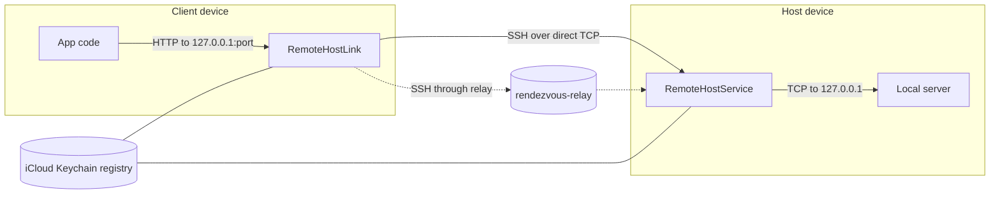

# device-tunnel

An end-to-end encrypted tunnel between the devices signed in to one Apple Account, with no pairing codes, certificates, or servers to run. Devices find each other through iCloud Keychain and Bonjour, dial each other directly whenever they can, and fall back to a [rendezvous-relay](https://github.com/bunchjesse/rendezvous-relay) when they can't. Every tunnel is an SSH session keyed by each device's Ed25519 key, so the relay — and anything else on the path — sees only ciphertext.

The tunnel carries TCP. A host runs an ordinary local server on `127.0.0.1`; a client gets a loopback port of its own for each host, and every connection to that port reaches the host's server. App code on both ends talks plain HTTP (or any TCP protocol) and never deals with the tunnel.

| Product | Contents | Platforms |
|---------|----------|-----------|
| `DeviceTunnel` | Device identity and registry, approvals, the host service, client links, Bonjour discovery, relay registration and dialing | macOS 26, iOS 26, visionOS 26 |

Everything is Swift built from source ([swift-nio-ssh](https://github.com/apple/swift-nio-ssh), [swift-nio-transport-services](https://github.com/apple/swift-nio-transport-services), rendezvous-relay's client), so it builds for every architecture an app does, including `arm64e`.

## How it works



- **Identity.** Each device creates one Ed25519 key on first launch and keeps it in its local, device-pinned Keychain (`DeviceIdentity`). The public key, as 64 lowercase hex digits, is the device's **endpoint ID**; a short hash of it is the device's **fingerprint** (`3f2a-91c0-77de-0b45`), which people compare because names prove nothing. A **gate key** is derived from the private key.
- **Registry.** Each device publishes a `DeviceRecord` — name, platform, whether it hosts, its gate key, its direct addresses, its relay — as one synchronized Keychain item (`DeviceRegistry`). iCloud Keychain carries these end to end encrypted to every device on the account, so membership in the registry is what "same Apple Account" means. Every device on the account can write every record, so nothing trusts a record's name.
- **Access gate.** Before SSH starts, a host sends a nonce and a tag proving it knows its gate key, and the client must answer with a proof under the same key (`AccessGate`). Anyone without the account's records never reaches SSH, so they never see the host's key and can't use up its handshake slots. Connections waiting at the gate are bounded per source address.
- **Discovery.** A host listens on every interface, advertises over Bonjour under a random name with a salted tag keyed by its gate key — never its endpoint ID or device name — and renews that advertisement whenever its network changes. It also publishes its addresses (and their forward-confirmed DNS names) in its record. Clients browse for the service type and recognize the tags of hosts they've dialed before, whose gate keys they learned from those hosts' records (`ServiceBrowser`).
- **Dialing.** A client races every route it knows — Bonjour results first, then the record's addresses — and the first to pass the access gate and finish the SSH handshake wins (`RemoteNode`). A record without a gate key comes from a build too old to reach, and the dial fails with `outdatedPeer`. If the host publishes a relay and the client allows relays, the relay joins the race 750 ms late, so a direct route that answers always wins. A relayed tunnel keeps probing direct routes and moves onto one as soon as it works (`RemoteHostLink`).
- **Trust, both ways.** A host admits a device whose key it finds in its copy of the registry, that its user approved once, while it accepts connections (`RemoteHostService`); approvals live in the host's **local** Keychain. A client dials only a host its own user trusts, in a local `TrustedHosts` store. Both decisions should be made by comparing fingerprints.
- **Revocation.** `DeviceRegistry.revoke(_:)` writes an account-wide revocation and hides the device's record. Because the revoked device can delete it again, every host and client turns each revocation it sees into a permanent local denial (`RemoteHostService.applyRevocations()`, which a running host also calls every minute, and `TrustedHosts.applyRevocations(_:)`). Approvals don't expire on their own.
- **Streams.** The first SSH channel is a control stream (`ClientHello`, then `HostReply` with an access token); every later channel carries one TCP connection to the host's local server, spliced byte for byte.

## Adopting it

Add the package:

```swift
.package(url: "https://github.com/bunchjesse/device-tunnel.git", from: "0.1.0"),
```

### Configuration

Pick names per build flavor so Debug and Release never see each other's devices:

```swift
let configuration = RemoteAccessConfiguration(
    keychainServicePrefix: "com.example.app",          // also the relay namespace
    keychainAccessGroup: "TEAMID.com.example.app",     // shared by the app's variants
    protocolName: "example/1",                         // SSH user name; never changes
    serviceType: "_example._tcp"                       // must be in NSBonjourServices
)
```

The app needs a `keychain-access-groups` entitlement naming the group, `NSLocalNetworkUsageDescription`, and the service type in `NSBonjourServices`.

### A host

```swift
let store = SystemKeychainStore(accessGroup: configuration.keychainAccessGroup)
let registry = DeviceRegistry(store: store, configuration: configuration)
let approvals = DeviceApprovals(store: store, configuration: configuration)
let identity = try DeviceIdentity.loadOrCreate(store: store, configuration: configuration)

let node = try await RemoteNode.start(identity: identity, configuration: configuration, acceptingDevicesIn: registry)
node.setRelay("relay.example.com")   // optional
try registry.publish(DeviceRecord(
    endpointID: identity.endpointID, gateKey: identity.gateKey, name: "Studio", platform: .macOS, canHost: true,
    directAddresses: node.address(), relayAddress: "relay.example.com:3340"
))

let service = RemoteHostService(node: node, environment: .init(
    registry: registry,
    approvals: approvals,
    hostName: { "Studio" },
    localPort: { myServer.port },
    token: { endpointID in myServer.token(for: endpointID) },
    revokeToken: { endpointID in myServer.revoke(endpointID) },
    // Show device.fingerprint; the user checks it against the one the device shows.
    requestApproval: { device in await askTheUser(about: device) },
    isAcceptingConnections: { true },
    connectionsChanged: { devices in /* update UI */ }
))
Task { await service.run() }
```

Republish the record when `node.onAddressChange` fires, after the addresses settle; registry writes are iCloud Keychain traffic to every device. Call `service.applyRevocations()` whenever you re-read the registry.

An app can approve every device on the account automatically, but then anything that can write the account's iCloud Keychain — a stolen device that's still signed in included — has full access until it's revoked.

#### What the local server must do

Every tunneled stream reaches the local server as a connection from `127.0.0.1`, exactly like one from any other process on the Mac, so the server must not treat loopback as trusted:

- **Require the token on every request**, and check it in constant time.
- **Check the `Host` header** against the hosts you expect, so a web page using DNS rebinding can't drive the server from a browser on either device.
- **Tell tunneled connections apart** with `service.tunneledDevice(fromLocalPort:)`, passing the connection's source port as soon as you accept it: it names the device a connection carries, or returns nil for a connection some local process made. It complements the token rather than replacing it, since a local process can reuse a port once its tunneled connection closes.

### A client

```swift
let trustedHosts = TrustedHosts(store: store, configuration: configuration)
let link = RemoteHostLink(node: node, host: hostRecord, trustedHosts: trustedHosts) { state in
    switch state {
    case .untrustedHost(let name, let fingerprint):
        // Ask the user to compare `fingerprint` with the one the host shows,
        // then `try trustedHosts.trust(hostRecord)` and `await link.reconnect()`.
    case .connected(let port, let token, let path):
        // http://127.0.0.1:\(port), Authorization: Bearer \(token), via path
    default: break
    }
}
await link.start()
```

Re-read the registry periodically, apply its revocations with `trustedHosts.applyRevocations(registry.revocations())`, hand record changes to `link.update(host:)`, and forward `node.onNetworkChange` / `node.onRoutesChange` to `link.networkChanged()` / `link.routesChanged()` so links redial at once when something that could help changes.

Any process on the client device can connect to the link's loopback port and reach the host as this device; the token is what keeps them out, so keep it in memory and don't hand the port to untrusted code.

## Relay

Run [rendezvous-relay](https://github.com/bunchjesse/rendezvous-relay) somewhere every device can reach on TCP 3340, allow your app's namespaces (`RELAY_ALLOWED_NAMESPACES=com.example.app,com.example.app.debug`), and give hosts its address. Clients use whichever relay a host publishes (`RemoteNode.setDialsThroughRelays(_:)`).

## Development

```bash
swift build
swift test
```

The tests run real hosts and clients on 127.0.0.1, and a relay in-process, so they need no deployment. See [AGENTS.md](AGENTS.md) for conventions.
