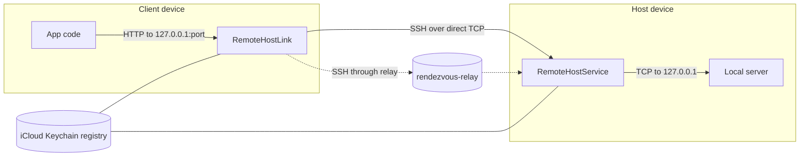

# device-tunnel

An end-to-end encrypted tunnel between the devices signed in to one Apple Account, with no pairing codes, certificates, or servers to run. Devices find each other through iCloud Keychain and Bonjour, dial each other directly whenever they can, and fall back to a [rendezvous-relay](https://github.com/bunchjesse/rendezvous-relay) when they can't. Every tunnel is an SSH session keyed by each device's Ed25519 key, so the relay — and anything else on the path — sees only ciphertext.

The tunnel carries TCP. A host runs an ordinary local server on `127.0.0.1`; a client gets a loopback port of its own for each host, and every connection to that port reaches the host's server. App code on both ends talks plain HTTP (or any TCP protocol) and never deals with the tunnel.

| Product | Contents | Platforms |
|---------|----------|-----------|
| `DeviceTunnel` | Device identity and registry, approvals, the host service, client links, Bonjour discovery, relay registration and dialing | macOS 26, iOS 26, visionOS 26 |

Everything is Swift built from source ([swift-nio-ssh](https://github.com/apple/swift-nio-ssh), [swift-nio-transport-services](https://github.com/apple/swift-nio-transport-services), rendezvous-relay's client), so it builds for every architecture an app does, including `arm64e`.

## How it works



- **Identity.** Each device creates one Ed25519 key on first launch and keeps it in its local, device-pinned Keychain (`DeviceIdentity`). The public key, as 64 lowercase hex digits, is the device's **endpoint ID**.
- **Registry.** Each device publishes a `DeviceRecord` — name, platform, whether it hosts, its direct addresses, its relay — as one synchronized Keychain item (`DeviceRegistry`). iCloud Keychain carries these end to end encrypted to every device on the account, so membership in the registry is what "same Apple Account" means.
- **Discovery.** A host listens on every interface, advertises over Bonjour with its endpoint ID in the TXT record, and publishes its addresses (and their forward-confirmed DNS names) in its record. Clients browse for the service type (`ServiceBrowser`).
- **Dialing.** A client races every route it knows — Bonjour results first, then the record's addresses — and the first to finish the SSH handshake wins (`RemoteNode`). If the host publishes a relay and the client allows relays, the relay joins the race 750 ms late, so a direct route that answers always wins. A relayed tunnel keeps probing direct routes and moves onto one as soon as it works (`RemoteHostLink`).
- **Admission.** A host admits a device whose key it finds in its copy of the registry, that its user approved once, while it accepts connections (`RemoteHostService`). Approvals live in the host's **local** Keychain; an app that trusts the whole account can approve every device automatically.
- **Streams.** The first SSH channel is a control stream (`ClientHello`, then `HostReply` with an access token); every later channel carries one TCP connection to the host's local server, spliced byte for byte.

## Adopting it

Add the package:

```swift
.package(url: "https://github.com/bunchjesse/device-tunnel.git", from: "0.1.0"),
```

### Configuration

Pick names per build flavor so Debug and Release never see each other's devices:

```swift
let configuration = RemoteAccessConfiguration(
    keychainServicePrefix: "com.example.app",          // also the relay namespace
    keychainAccessGroup: "TEAMID.com.example.app",     // shared by the app's variants
    protocolName: "example/1",                         // SSH user name; never changes
    serviceType: "_example._tcp"                       // must be in NSBonjourServices
)
```

The app needs a `keychain-access-groups` entitlement naming the group, `NSLocalNetworkUsageDescription`, and the service type in `NSBonjourServices`.

### A host

```swift
let store = SystemKeychainStore(accessGroup: configuration.keychainAccessGroup)
let registry = DeviceRegistry(store: store, configuration: configuration)
let approvals = DeviceApprovals(store: store, configuration: configuration)
let identity = try DeviceIdentity.loadOrCreate(store: store, configuration: configuration)

let node = try await RemoteNode.start(identity: identity, configuration: configuration, acceptingDevicesIn: registry)
node.setRelay("relay.example.com")   // optional
try registry.publish(DeviceRecord(
    endpointID: identity.endpointID, name: "Studio", platform: .macOS, canHost: true,
    directAddresses: node.address(), relayAddress: "relay.example.com:3340"
))

let service = RemoteHostService(node: node, environment: .init(
    registry: registry,
    approvals: approvals,
    hostName: { "Studio" },
    localPort: { myServer.port },
    token: { endpointID in myServer.token(for: endpointID) },
    revokeToken: { endpointID in myServer.revoke(endpointID) },
    requestApproval: { device in await askTheUser(about: device) },
    isAcceptingConnections: { true },
    connectionsChanged: { devices in /* update UI */ }
))
Task { await service.run() }
```

Republish the record when `node.onAddressChange` fires, after the addresses settle; registry writes are iCloud Keychain traffic to every device.

### A client

```swift
let link = RemoteHostLink(node: node, host: hostRecord) { state in
    if case .connected(let port, let token, let path) = state {
        // http://127.0.0.1:\(port), Authorization: Bearer \(token), via path
    }
}
await link.start()
```

Re-read the registry periodically, hand record changes to `link.update(host:)`, and forward `node.onNetworkChange` / `node.onRoutesChange` to `link.networkChanged()` / `link.routesChanged()` so links redial at once when something that could help changes.

## Relay

Run [rendezvous-relay](https://github.com/bunchjesse/rendezvous-relay) somewhere every device can reach on TCP 3340, allow your app's namespaces (`RELAY_ALLOWED_NAMESPACES=com.example.app,com.example.app.debug`), and give hosts its address. Clients use whichever relay a host publishes (`RemoteNode.setDialsThroughRelays(_:)`).

## Development

```bash
swift build
swift test
```

The tests run real hosts and clients on 127.0.0.1, and a relay in-process, so they need no deployment. See [AGENTS.md](AGENTS.md) for conventions.
